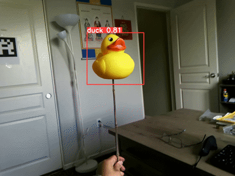

# AR Object Detection

**Train an object detector without manually annotating images.** This MATLAB + Python workflow automatically generates all project-specific bounding-box annotations, starting from synthetic 3D renders and expanding to real scenes through high-confidence predictions. No hand-drawn boxes or manual correction of training labels is required.

Yellow duck is the current reproduction focus; bike and laser configurations are retained.

## Yellow duck detection preview



[Watch or download the full MP4 (50 seconds)](docs/media/yellow-duck-detection.mp4) · [Still frame](docs/media/yellow-duck-detection.png)

Historical annotated output from the Python detection stage, showing the duck at different viewing angles with bounding boxes and confidence scores. The animation is an 8-second excerpt; the MP4 contains the complete saved result. Original predictions are retained, with only resizing and re-encoding for preview. This is an existing result, not a newly reproduced end-to-end training run.

The training workflow generates its object annotations automatically; no manual bounding-box annotation is required. [Preview provenance](docs/media/yellow-duck-detection.json). To regenerate these media files from the original annotated recording, run `exportDuckDemo` in MATLAB after local asset setup; the exporter refuses to overwrite existing demo files.

## Workflow

KIRI Engine scan on iPhone → 3D render on black → automatic MATLAB foreground boxes → small YOLOv2 bootstrap detector → confident real-scene candidates → YOLOv8 training → repeated candidate selection and retraining.

## How annotations are generated automatically

| Stage | Automatic annotation source |
|---|---|
| Synthetic bootstrap | MATLAB separates the rendered object from its black background and computes its bounding box. |
| First real-scene training set | The small YOLOv2 detector predicts boxes; confidence filtering selects candidates for YOLOv8 training. |
| Subsequent training iterations | YOLOv8 predicts boxes on real footage; high-confidence predictions become labels for the next iteration. |

The feedback loop replaces manual annotation throughout the training workflow. Scanning an object with KIRI Engine and rendering views are preparation steps; they do not require manually drawing labels. Existing pretrained checkpoints may initialize the networks; the automatic-annotation claim concerns labels generated within this project.

Scanning and rendering are external steps. Source code for those stages was not part of the recovered project.

## Structure

| Directory | Purpose |
|---|---|
| matlab/+ar | Synthetic preparation, box conversion, YOLOv2 training, prediction, label export |
| matlab/label*.m | Labeling-app adapters |
| python | YOLOv8 command line workflow and local asset setup |
| configs | Portable configuration and recording split examples |
| tests | MATLAB geometry and Python dataset checks |
| docs | Asset setup and yellow-duck reproduction guide |

Recordings, model weights, datasets, historical scripts, vendor code, local configuration, and generated runs are ignored by Git, with the selected small result preview under docs/media included for demonstration. The original project folders remain unchanged.

## Setup

Clone the repository and configure your local files:

```powershell
python python/setup_local.py --matlab-root "PATH_TO_ORIGINAL_MATLAB_FOLDER" --python-root "PATH_TO_ORIGINAL_PYTHON_FOLDER"
```

Review the generated configs/project.json, especially the external source folders and rtsp_url. Relative model/output paths resolve from the repository root. See [local assets](docs/assets.md).

Use a fresh Python environment compatible with your PyTorch/Ultralytics installation, then install `python/requirements.txt`. Historical package versions were not recorded; this file is not a recovered environment lock.

In MATLAB, make the repository your current folder and run:

```matlab
addpath(fullfile(pwd,'matlab'));
cfg = ar.config('duck');
video = fullfile(cfg.original_matlab_root,'duck1.mp4');
ar.detectVideo('duck',video,'duck_preview_001');
```

For MATLAB R2026b+, matlab.toml also declares the source/test paths. R2026a users should use the addpath command above. Required products include Computer Vision Toolbox, Image Processing Toolbox, and Deep Learning Toolbox. See the [yellow-duck steps](docs/duck-workflow.md) before retraining.

## Python commands

```powershell
python python/pipeline.py --help
python python/pipeline.py predict --object duck --source glasses --name duck_live_001 --show
python python/pipeline.py pseudo-label --object duck --source "PATH_TO_RECORDING.mp4" --name recording_a_001 --confidence 0.85
python python/pipeline.py split --object duck --manifest configs/my-split.json --output datasets/duck/assembled_001
python python/pipeline.py train --object duck --data datasets/duck/assembled_001/dataset.yaml --model models/python/yolov8s.pt --name duck_001 --epochs 50
```

Copy configs/split.example.json to a new manifest and replace the examples with real, separate recording sessions. Keep all feedback iterations from one recording in the same partition. Train, validation, and test folders can all use automatically generated labels; no manually labeled split is required to run the workflow. Optional human review or independent accuracy assessment is separate from training. Candidate exports record source/model/confidence provenance; each run uses a new name. Candidate generation currently selects at most one object per frame, matching the historical experiments.

## Verification

```powershell
python -m unittest discover -s tests -p test_pipeline.py -v
```

```matlab
runtests('tests/test_matlab_geometry.m')
```

Python checks cover dataset assembly, malformed coordinates, exact duplicate images across partitions, overwrite protection, and portable configuration. Local model paths are checked when local configuration exists; that check is skipped on clean clones.

The MATLAB geometry tests and historical detector sample inference were verified on R2026a Update 3. Full retraining and live glasses streaming are ongoing reproduction work.
